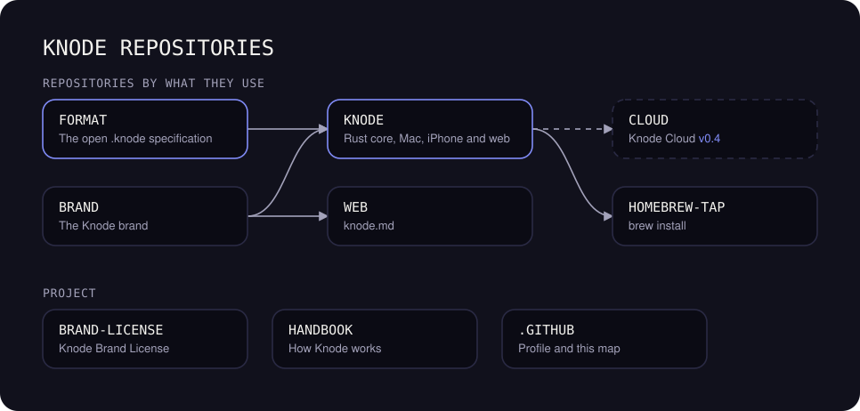

  

<h3 align="center">Connect your thoughts. Naturally.</h3>

  Your second brain for AI: one local memory that every agent you use can read and add to, 
  in open <code>.knode</code> files, with a native app. Local first, open source.

  <a href="https://knode.md">knode.md</a>&emsp;
  <a href="https://github.com/knodemd/handbook">Handbook</a>&emsp;
  <a href="https://github.com/knodemd/brand">Brand</a>

---

Knode is in early development and **built in public**: every decision, issue and line of code is here from day one.

| Repository | What it is |
|---|---|
| [`knode`](https://github.com/knodemd/knode) | The product: the Rust core and the Mac, iPhone and web apps |
| [`format`](https://github.com/knodemd/format) | The open `.knode` specification |
| [`homebrew-tap`](https://github.com/knodemd/homebrew-tap) | `brew install knodemd/tap/knode` |
| [`web`](https://github.com/knodemd/web) | [knode.md](https://knode.md): the website |
| [`brand`](https://github.com/knodemd/brand) | The brand kit |
| [`brand-license`](https://github.com/knodemd/brand-license) | The Knode Brand License and the trademark policy |
| [`handbook`](https://github.com/knodemd/handbook) | How the project works: principles, roadmap, decisions |
| [`.github`](https://github.com/knodemd/.github) | This profile, the shared community files and the map above |

Want to help? Start with the [handbook](https://github.com/knodemd/handbook) and the [contributing guide](https://github.com/knodemd/.github/blob/main/CONTRIBUTING.md).
