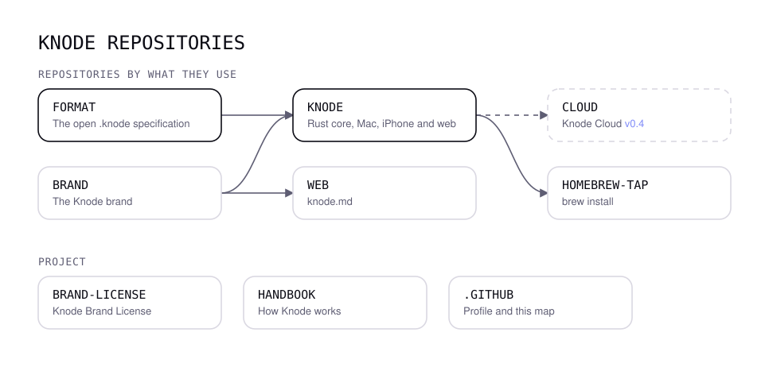
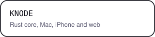
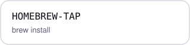

  

<h3 align="center">Connect your thoughts. Naturally.</h3>

  Your second brain for AI: one local memory that every agent you use can read and add to, 
  in open <code>.knode</code> files, with a native app. Local first, open source.

  &nbsp;
  &nbsp;
  &nbsp;
  

---

Knode is in early development and **built in public**: every decision, issue and line of code is here from day one.

<picture>
  <source media="(prefers-color-scheme: dark)" srcset="map-dark.svg">
  
</picture>

<!-- repos:start -->

<a href="https://github.com/knodemd/format"><picture><source media="(prefers-color-scheme: dark)" srcset="repos/format-dark.svg"></picture></a>
<a href="https://github.com/knodemd/knode"><picture><source media="(prefers-color-scheme: dark)" srcset="repos/knode-dark.svg"></picture></a>
<a href="https://github.com/knodemd"><picture><source media="(prefers-color-scheme: dark)" srcset="repos/cloud-dark.svg"></picture></a>

<a href="https://github.com/knodemd/homebrew-tap"><picture><source media="(prefers-color-scheme: dark)" srcset="repos/homebrew-tap-dark.svg"></picture></a>
<a href="https://github.com/knodemd/web"><picture><source media="(prefers-color-scheme: dark)" srcset="repos/web-dark.svg"></picture></a>
<a href="https://github.com/knodemd/brand"><picture><source media="(prefers-color-scheme: dark)" srcset="repos/brand-dark.svg"></picture></a>

<a href="https://github.com/knodemd/brand-license"><picture><source media="(prefers-color-scheme: dark)" srcset="repos/brand-license-dark.svg"></picture></a>
<a href="https://github.com/knodemd/handbook"><picture><source media="(prefers-color-scheme: dark)" srcset="repos/handbook-dark.svg"></picture></a>
<a href="https://github.com/knodemd/.github"><picture><source media="(prefers-color-scheme: dark)" srcset="repos/github-dark.svg"></picture></a>

<!-- repos:end -->

Want to help? Start with the [handbook](https://github.com/knodemd/handbook) and the [contributing guide](https://github.com/knodemd/.github/blob/main/CONTRIBUTING.md).
